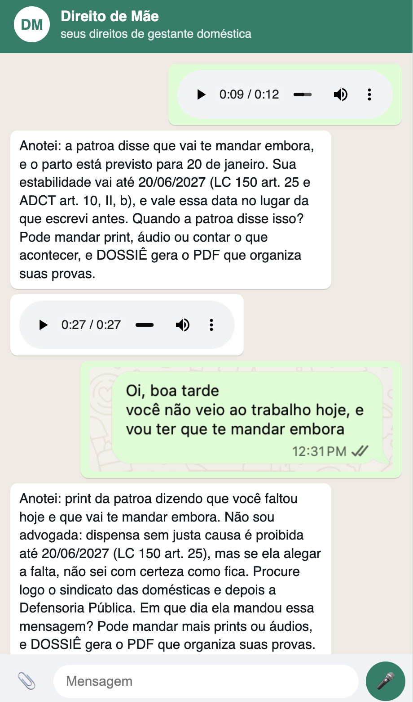
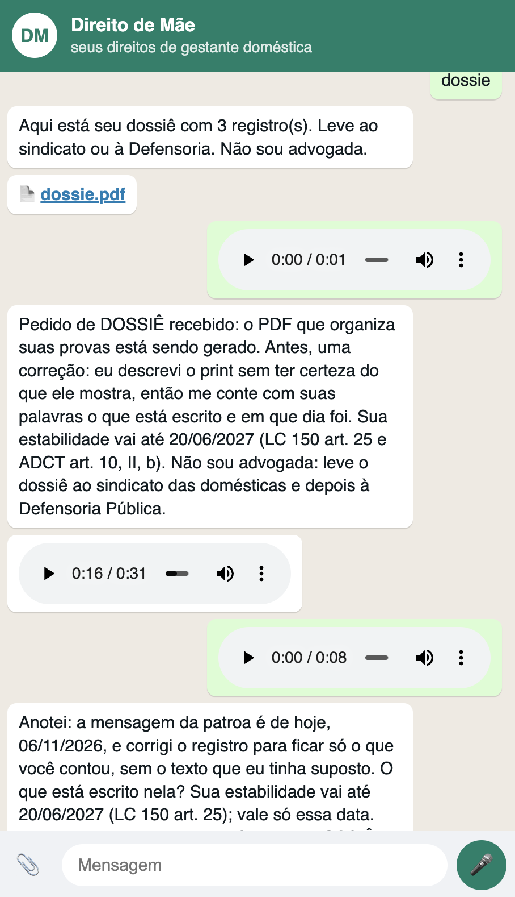
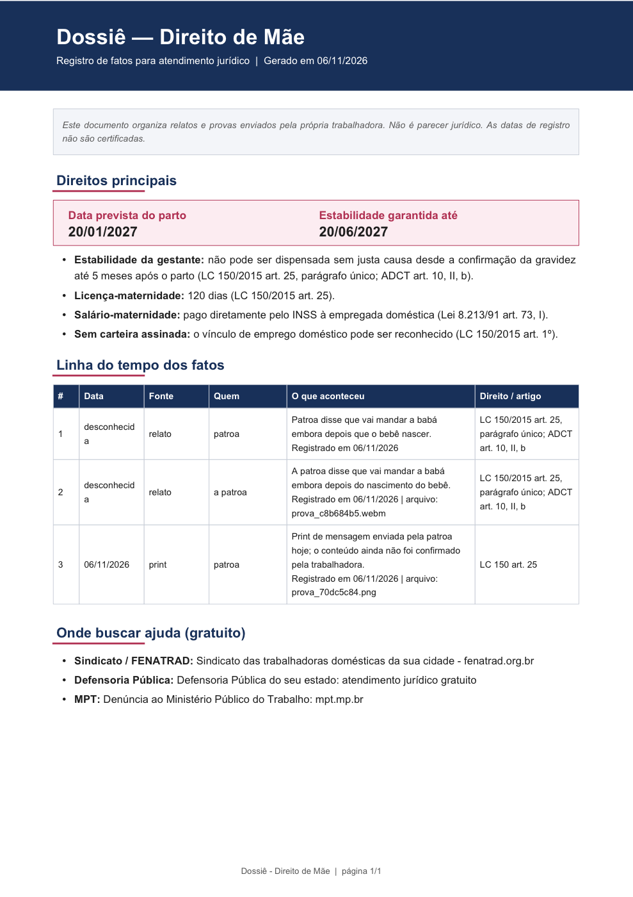

# Direito de Mãe

**A voice-first helper for pregnant domestic workers in Brazil.** She talks to it like she talks on WhatsApp, with voice notes, screenshots or text. It tells her which rights she has (only from Brazilian law we curate, always citing the article), keeps a dated record of what her employer does, and turns that record into a **dossiê** PDF she can take to her union or the Defensoria Pública (free public legal aid).

## Why
- Only **8%** of new mothers in Brazil know all 16 of their labour rights, and **54%** had at least one broken ([FAPESP, Feb 2026](https://agencia.fapesp.br/57148)).
- **Domestic workers** (nannies, housekeepers, caregivers) have it worst. Their employer is a family, so there's no HR department and no witnesses, and many work without a signed work card. They still have rights under **LC 150/2015** (the domestic workers law), but they rarely know it.
- Many of them don't read well, and none of them will type "quais meus direitos segundo a LC 150" into a chatbot. General assistants answer whatever they're asked. This one asks her about her situation, listens, and organises her evidence.

## How it helps, step by step

| | |
|---|---|
|  | **1. She just talks.** She sends a voice note: *"I'm a nanny, no work card, 6 months pregnant, due 20 January. My boss says she'll let me go after the baby is born."*  **2. It answers in plain words, with the law.** Her job is protected until **20/06/2027**. That date is **calculated by code**, never guessed by the AI. The answer cites **LC 150 art. 25** and **ADCT art. 10, II, b**. Every reply is also **read back as a voice note**, so she never has to read.  **3. Her evidence becomes a record.** She sends a screenshot of the boss's message (*"you didn't come in today, I'll have to let you go"*). It logs the incident (*"Anotei"*), says **"Não sou advogada"** (I'm not a lawyer), and points her to the **domestic workers' union first, then the Defensoria Pública**. It also asks for the date, since a case needs one. |
|  | **4. One word, by voice or text: "dossiê".** She gets a PDF with everything she's sent, organised.  She can say it out loud too. Voice commands work even when speech-to-text mishears it (*"quero meu doce"*). |
|  | **5. A document a lawyer can use.** It shows her due date and her job-protection end date, her key rights with articles, a dated timeline (who, what, source, related law, attached file), and where to get free help. It says clearly that it **organises her evidence and is not legal advice**. |

## Trust & safety
- **Grounded:** Claude may only answer from [`laws.md`](laws.md), and must cite the article. If something isn't covered, it says "não sei com certeza" and sends her to human help. To update the law, edit one file.
- **No made-up dates:** a tested function computes job-protection dates from her due date.
- **Human handoff, every time a right looks broken:** union → Defensoria → Ministério Público do Trabalho.
- **Private by default:** no name or phone number stored, only a salted hash. Each browser gets its own session, and **APAGAR** deletes all her data and files.
- **Abuse limits:** per-IP rate limit, file size and type checks.

## Stack
Python + FastAPI · Claude (`claude-sonnet-5-5`, reads screenshots directly) · ElevenLabs (speech-to-text + voice replies) · ffmpeg · fpdf2 · WhatsApp-style web chat (a Twilio WhatsApp path is in progress on the `twilio` branch).

## What's next
Real WhatsApp number · formal (CLT) and informal workers · proactive reminders before key dates · partnerships with domestic workers' unions (FENATRAD) and the Defensoria.

## Files
| File | Job |
|---|---|
| `app.py` | Receives WhatsApp messages (Twilio), routes them, sends replies |
| `brain.py` | Claude prompt + rules; `job_protection_end()` computes the date in code |
| `voice.py` | ElevenLabs speech-to-text and text-to-speech, ffmpeg → voice note |
| `dossie.py` | Builds the PDF |
| `store.py` | One JSON file per user, named by a salted hash (no phone stored) |
| `laws.md` | The law the app is allowed to use. Edit it, restart, done |

## Run it (laptop)
1. `cp .env.example .env` and fill in `ANTHROPIC_API_KEY`, `ELEVENLABS_API_KEY`, `ELEVENLABS_VOICE_ID` and `HASH_SALT`.
2. Install: `uv venv .venv && uv pip install -p .venv -r requirements.txt` (also needs `ffmpeg`).
3. Start: `.venv/bin/uvicorn app:app --port 8000`, then open http://localhost:8000
4. Optional public link: `ngrok http --url=<your-static-domain> 8000`

## Test
`.venv/bin/python -m pytest -q test_offline.py` (no keys needed)
